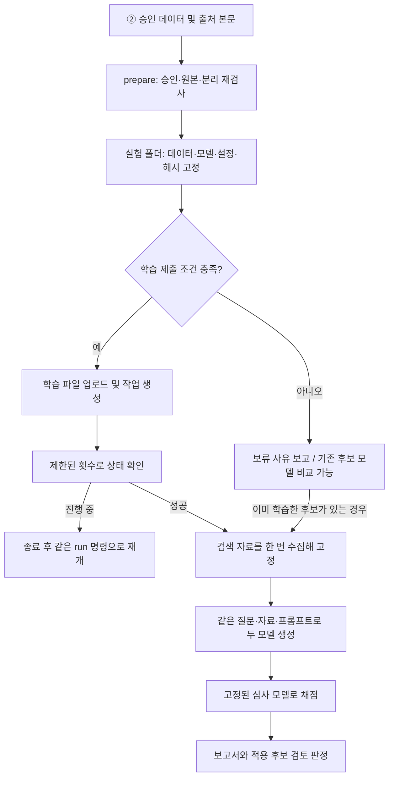

# ③ 학습·비교 평가 자동화

다음 작업의 권장 순서와 단계별 완료 조건은 [이후 학습 진행 계획](FEEDBACK_TRAINING_NEXT_STEPS.md)을 참고합니다.

`eval/tools/automate_feedback_training.py`는 ②의 승인 데이터에서 학습 입력을 만들고,
이용 가능한 기존 OpenAI 파인튜닝 계정의 학습 작업을 제출한 뒤 기존 모델과 후보 모델의 답변을 비교합니다.
`prepare`는 오프라인 작업입니다. `run`은 학습 제출 → 제한된 상태 조회 → 검색 자료 고정 →
두 모델 생성·채점 → 보고서를 연결합니다. 작업 대기 중에는 종료하므로 같은 명령으로 이어갑니다.
이미 학습한 OpenAI `ft:...` 모델이 있으면 추가 학습 제출 없이 비교할 수 있습니다.
학습·추론 연결은 공식 OpenAI API 전용이며 다른 제공자로 자동 전환하지 않습니다.

## 현재 데이터와 제공자 조건

2026-11-16에 확인한 ②의 결과는 `var/feedback/stage2_live_20261116_01`입니다.
학습 가능 3건, 신규 평가 0건이며, 기존 평가 출처와 겹친 2건과 검수 대기 9건은 제외되었습니다.
이번 구현에서는 이 데이터나 승인 상태를 변경하지 않았습니다.

OpenAI 공식 문서는 최소 학습 예제 **10건**을 요구합니다. 현재 3건은 실제 학습 제출을 차단합니다.
검수와 출처 본문 확인을 통과한 서로 다른 질문을 더 확보하고 ②부터 다시 변환해야 합니다.
같은 질문을 복제하거나 보호된 평가 질문을 학습으로 옮겨 건수를 채우지 않습니다.

또한 현재 파인튜닝은 신규 사용자에게 제공되지 않으며, 이용 가능한 기존 고객의 작업 생성도
2027-01-06 또는 선택 모델의 더 이른 종료일까지로 안내됩니다. 스크립트는 모델 이름을 자동 선택하지 않고,
명시한 ID를 그대로 사용합니다. 계정 자격·모델별 지원·종료일은 제공자 측에서 최종 판단합니다.
10건을 충족해도 해당 계정에서 학습할 수 있다고 보장하지 않습니다.
현재 구현은 2027-01-06 UTC 날짜부터 신규 학습 제출을 차단합니다.
[공식 SFT 안내](https://developers.openai.com/api/docs/guides/supervised-fine-tuning),
[모델 종료 안내](https://developers.openai.com/api/docs/deprecations).

## 구성과 작동 과정



1. **준비**: ②의 실시간 대조 완료 여부, 원본 피드백 해시와 부모 관계, 승인·개인정보·맥락 확인,
   보호 평가 출처 및 질문 중복을 다시 검사합니다. `ready.jsonl`을 재변환한 결과가 ②의 출력과 같아야 합니다.
   선택한 비교 질문도 추가로 학습과 겹치지 않는지 확인합니다.
2. **학습 입력**: 승인된 정답에 저장된 출처 본문과 고정 날짜를 붙입니다. 검수자가 확인한 URL의
   본문이 없거나 인용 번호가 유효하지 않으면 제출을 보류합니다. 기존 오답·사용자 의견·검수자 이름은
   업로드하지 않습니다. 출처 본문과 인용 번호의 의미가 검수 정답과 일치하는지도 검수에서 확인해야 합니다.
3. **작업 제출**: `purpose=fine-tune`으로 학습 파일만 업로드하고 supervised 작업을 생성합니다.
   평가 파일을 `validation_file`로 보내지 않습니다. 작업 ID와 파일 ID를 보관하며 재개 시 다시 생성하지 않습니다.
   SDK의 자동 재시도도 끕니다. [공식 작업 생성 API](https://developers.openai.com/api/reference/resources/fine_tuning/subresources/jobs/methods/create).
4. **검색 고정**: `/ask`를 질문마다 한 번 호출해 `include_evidence=true`로 자료를 저장합니다.
   캡처 시 생성된 답변은 정답이나 기준 답변으로 사용하지 않습니다. 평가 라벨은 별도의 검수된 케이스에서 가져옵니다.
5. **동일 조건 비교**: 캡처한 날짜·검색 본문과 운영 `build_user_message` 빌더로 프롬프트를 재구성합니다.
   두 모델의 시스템/사용자 메시지, temperature, 출력 길이가 같습니다. 실제 응답 모델 ID·생성 시간·토큰도 기록합니다.
   케이스마다 실행 순서를 번갈아 배치하며, 채점 프롬프트에는 모델 이름을 넣지 않습니다.
6. **채점·보고**: 기존 `grade_eval_results`와 `quality`의 채점 규약을 사용합니다. 심사 모델에는 생성 모델이
   실제 본 출처 본문만 제공합니다. 금지 주장 재확인 호출까지 실험 전체 호출 상한에 포함합니다.
   잘린 출력·거부 응답·비어 있는 답변·채점 오류는 정상 결과로 계산하지 않습니다.

## 실행 준비

프로젝트 루트 PowerShell에서 실행합니다. `backend/.env`의 `OPENAI_API_KEY`를 사용합니다.
검색 캡처 인증에는 `ASK_API_TOKEN`, 없으면 `FEEDBACK_API_TOKEN`을 사용합니다.
이미 설정된 프로세스 환경 변수가 `.env`보다 우선합니다. 토큰은 `Bearer ` 없이 저장합니다.
실험 폴더에는 질문·자료·답변이 있으므로 기존 `var/` 아래에 보관합니다.

```powershell
Set-Location D:\Github\campus-rag\campus-rag

# 모델 ID는 실제 계정에서 지원하는 값을 입력합니다.
$trainBaseModel = Read-Host '학습 원본 모델 ID'
$baselineModel = Read-Host '현재 운영 OPENAI_MODEL의 모델 ID'
$judgeModel = Read-Host '고정 심사 모델 ID (후보 모델과 다른 모델)'
$experimentDir = "var\feedback\training_$(Get-Date -Format yyyyMMdd_HHmmss)"

.\.venv\Scripts\python.exe -m eval.tools.automate_feedback_training prepare `
  --dataset-dir var\feedback\stage2_live_20261116_01 `
  --run-dir $experimentDir `
  --base-model $trainBaseModel `
  --baseline-model $baselineModel `
  --judge-model $judgeModel

Get-Content "$experimentDir\preflight.md" -Encoding UTF8
```

현재 데이터에서는 `minimum_training_examples:10;available:3`이 기록되어야 합니다.
출처 본문이 누락된 경우에는 해당 사유와 함께 학습 건수가 더 적게 나올 수 있습니다.
학습 데이터가 늘면 ②를 다시 실행하고 그 새 결과 폴더로 **새 실험 폴더**를 만듭니다.
과거 실험 안의 파일을 수정해 재사용하지 않습니다.

평가 케이스 기본값은 기존 회귀 100문항 + 졸업요건 2문항이며 ②의 평가용 승인 데이터도 추가합니다.
`--cases <파일>`을 반복하면 기본 두 파일을 대신하는 케이스들을 지정합니다.
여러 파일 사이 중복 ID/질문은 거부합니다. 작은 검증용 집합은 `--min-cases` 기본값 20에 못 미치므로
적용 후보로 추천되지 않습니다. 보호 평가 목록은 비교용 집합을 줄여도 그대로 유지합니다.
②에 사용자 지정 holdout을 썼다면 준비 단계에도 같은 파일을 `--holdout`으로 전달합니다.

## 학습과 비교를 이어서 실행

**10건 이상의 데이터 조건을 만족하고 실제 이용 가능한 기존 파인튜닝 계정일 때** 실행합니다.
`--eligible-account`는 해당 계정 조건을 운영자가 확인했다는 명시적 옵션입니다.
캡처 대상은 실행 중인 백엔드의 주소이며 프론트엔드 `/api` 주소를 쓰면 안 됩니다.
`--data-snapshot`은 운영자가 부여하는 DB/적재 버전 이름이며 실제 DB 스냅샷을 만들지는 않습니다.

```powershell
.\.venv\Scripts\python.exe -m eval.tools.automate_feedback_training run `
  --run-dir $experimentDir `
  --base-url http://localhost:8000 `
  --data-snapshot 'campus-rag-20261116' `
  --eligible-account `
  --max-polls 5 --poll-seconds 15
```

학습 진행 중에는 종료 코드 3으로 끝납니다. 같은 명령을 나중에 다시 실행하면 기존 작업 상태를 확인합니다.
성공했을 때만 캡처와 비교를 진행합니다. 실패·취소는 코드 2입니다.
준비/캡처/학습 API/비교 API를 이 문서를 작성하면서 실행하지 않았으며, 실행 비용은 사용자가 이 명령을 실행할 때 발생합니다.

이미 이용 가능한 후보 모델이 있다면 3건 데이터에서도 학습 제출을 생략하고 비교할 수 있습니다.

```powershell
$candidateModel = Read-Host '이미 학습한 OpenAI ft: 후보 모델 ID'
.\.venv\Scripts\python.exe -m eval.tools.automate_feedback_training run `
  --run-dir $experimentDir `
  --base-url http://localhost:8000 `
  --data-snapshot 'campus-rag-20261116' `
  --candidate-model $candidateModel
```

이 경로는 추가 학습 작업을 제출하지 않습니다. 비교 모델은 공식 OpenAI API에서
Chat Completions의 temperature/max_tokens/JSON 채점을 지원하는 모델이어야 합니다.
후보 모델은 기존 모델·심사 모델과 달라야 하고 한 실험 안에서 바꿀 수 없습니다.

## 단계를 따로 실행하거나 기존 캡처 사용

```powershell
# 데이터 조건을 충족한 경우에만 학습 제출
.\.venv\Scripts\python.exe -m eval.tools.automate_feedback_training submit `
  --run-dir $experimentDir --eligible-account

.\.venv\Scripts\python.exe -m eval.tools.automate_feedback_training status `
  --run-dir $experimentDir --max-polls 5 --poll-seconds 15

.\.venv\Scripts\python.exe -m eval.tools.automate_feedback_training capture `
  --run-dir $experimentDir --base-url http://localhost:8000 --data-snapshot 'campus-rag-20261116'

# 성공한 학습 작업의 모델을 자동 사용합니다.
.\.venv\Scripts\python.exe -m eval.tools.automate_feedback_training compare --run-dir $experimentDir
```

이미 `eval_ask`로 저장한 결과를 사용할 때는 `capture` 대신 다음을 실행합니다.
필요하면 `--results`를 반복하며, 모든 케이스가 정확히 한 번 포함되고 질문·프롬프트 해시가 일치해야 합니다.

```powershell
.\.venv\Scripts\python.exe -m eval.tools.automate_feedback_training freeze `
  --run-dir $experimentDir `
  --results eval\results\regression_captured.jsonl `
  --results eval\results\graduation_captured.jsonl `
  --data-snapshot 'campus-rag-20261116'
```

## 보고서와 판정 해석

| 파일 | 역할 |
| --- | --- |
| `manifest.json`, `preflight.md` | 모델·학습/생성/채점 설정, 입력·코드 해시, 학습 보류 사유 |
| `train.jsonl` | 출처 본문이 포함된 승인 정답만 있는 실제 업로드 입력 |
| `cases.jsonl`, `approved.jsonl`, `system.txt` | 고정 평가 라벨·승인 원본·시스템 프롬프트 |
| `state.json` | 학습 작업·파일 ID, 완료 상태, 호출 상한 소비량, 진행 파일 해시 |
| `capture.jsonl`, `contexts.jsonl` | 수집 자료와 두 모델이 공유하는 고정 메시지 |
| `comparison.jsonl` | 케이스별 두 답변·채점·인용·시간·토큰·오류 |
| `report.json`, `report.md` | 전체/분류별 품질 지표, 개선·퇴보 ID, 판정 사유 |

`review_candidate`는 다음을 모두 충족할 때의 **검토 대상** 판정입니다.

- 모든 케이스의 두 답변과 채점이 완료되고 미확인 근거·미확인 범위 판정이 없음.
- 기본 20문항 이상이며 엄격 정답률이 기본 0.02(2%p) 이상 개선됨.
- 필수 사실 충족도가 떨어지지 않고 금지 주장·근거 없는 주장·과도한 거절·학과/시점 오류가 늘지 않음.
- 기존에 정답이었던 케이스가 오답으로 바뀌지 않음.

그 외는 `hold`입니다. 불완전 평가의 종료 코드는 2이며, 완료된 평가의 품질 보류는 코드 0과
보고서의 `hold`로 구분합니다. `review_candidate`도 통계적 유의성이나 운영 적용 승인을 뜻하지 않습니다.
필요하면 독립적인 최종 평가와 반복 실험으로 확인합니다. 운영 모델 설정은 자동으로 바꾸지 않습니다.

이 비교는 **고정된 검색 결과에서의 단일 턴·단일 생성** 실험입니다. 운영 중의 검색, 분기,
대화 이력, 숫자 검증 후 재작성은 포함하지 않습니다. 직접 답변·명확화·거절 경로, 검색 장애,
답변 가능하지만 자료가 없는 케이스는 제외 사유를 저장하고 불완전 평가로 처리합니다.
기본 102문항에는 이런 경로가 포함될 수 있으므로 전체 서비스 성능은 기존 `eval_ask`로 별도 평가해야 합니다.
제외 항목을 지워 과거 평가와 같은 범위의 점수라고 보고하지 않습니다.

비교 호출 상한은 기본 `4 × 문항 수 + 2 × 금지 주장 수`입니다. 생성 2회, 기본 채점 2회,
필요한 금지 주장 재확인까지 포함합니다. 스키마 오류 재채점은 하지 않습니다.
캡처는 케이스당 `/ask` HTTP 1회이며, **백엔드 내부 검색 계획·답변 생성의 모델 호출 수는 이 상한 밖**입니다.
학습 토큰, 비교 모델별 토큰, 캡처 요청 수를 구분하며 실제 금액은 제공자 청구 내역으로 확인합니다.

호출 수 상한은 달러 기준의 결제 한도가 아닙니다. 학습비는 대략
`예제당 토큰 × 예제 수 × epochs ÷ 1,000,000 × 학습 단가`로 계산하고, 추론·심사비는 따로 더합니다.
예를 들어 100만 학습 토큰당 $5인 단가를 가정하면 10건 × 2,000토큰 × 3회 학습은 약 $0.30입니다.
이는 실제 데이터의 견적이 아니며 비교·검색 캡처·세금·환율은 포함하지 않습니다.
현재 준비한 데이터가 3건인 상태에서 학습을 시도하면 업로드/작업 생성 전에 차단합니다.
[공식 요금표](https://developers.openai.com/api/docs/pricing).

## 중단·재개와 복구

완료한 비교 쌍은 같은 명령을 다시 실행해도 재호출하지 않습니다. 데이터·설정·코드·고정 자료·진행 파일이
바뀌면 재개를 차단합니다. 한 실험에는 한 프로세스만 접근하도록 `.experiment.lock`을 사용합니다.
프로세스가 비정상 종료해 잠금이 남았다면 파일에 기록된 PID가 더 이상 실행 중이 아닌지 먼저 확인한 뒤
**해당 실험 폴더의 잠금 파일 하나만** 직접 제거합니다.

업로드/학습 생성 요청의 응답을 잃으면 `upload_intent`/`submit_intent` 상태로 남습니다.
이때 자동 재제출하지 않습니다. 제공자 대시보드에서 기존 ID를 찾아 연결합니다.
파일은 서버의 내용 해시를, 작업은 모델·학습 파일 ID 일치를 확인합니다.

```powershell
# 업로드 응답을 잃은 경우: 실제 존재하는 파일 ID를 입력
.\.venv\Scripts\python.exe -m eval.tools.automate_feedback_training attach `
  --run-dir $experimentDir --file-id 'file-실제ID'

# 작업 생성 응답을 잃은 경우: 위 파일과 연결된 실제 작업 ID를 입력
.\.venv\Scripts\python.exe -m eval.tools.automate_feedback_training attach `
  --run-dir $experimentDir --job-id 'ftjob-실제ID'
```

유료 캡처/생성/채점 도중 중단되어 결과를 저장하지 못한 경우도 자동 재호출하지 않습니다.
캡처는 저장된 결과와 별도 확보한 나머지 결과를 `freeze`로 결합하거나 새 실험을 만듭니다.
비교의 불확실한 요청이나 저장된 API/채점 오류를 재시도하려면 원인을 해결한 뒤 새 실험을 만듭니다.
파일은 신뢰한 로컬 산출물로 취급합니다. 해시는 변경 감지용이며 관리자 권한의 조작을 막는 전자서명은 아닙니다.
②의 실시간 확인 시각은 기록하지만 그 이후 서버 피드백이 바뀌지 않았다고 보장하지는 않습니다.
제출 직전 최신 상태가 필요하면 ②를 다시 실행해 새 실험을 준비합니다.

## 이번 구현의 검증 상태

네트워크 없는 가짜 클라이언트 테스트를 추가했습니다. 2026-11-16 사용자의 직접 실행 요청에 따라
아래 테스트를 실행해 **87개 통과**를 확인했습니다. 실제 데이터 변환, 학습 제출, 검색 캡처,
유료 모델 비교 평가는 실행하지 않았습니다.

```powershell
.\.venv\Scripts\python.exe -m pytest `
  eval\tests\test_automate_feedback_training.py `
  eval\tests\test_automate_feedback_review.py `
  eval\tests\test_grade_eval_results.py `
  eval\tests\test_quality_baseline.py `
  backend\tests\test_generation.py
```

테스트는 최소 건수 차단, 데이터 오염, 같은 입력으로 비교, 불완전 평가 보류, 호출 상한,
중복 제출 방지, 기존 OpenAI 후보 모델 경로, 학습 대기 시 캡처 중단, 인증 정보 비노출을 확인하도록 작성했습니다.
실제 계정의 학습 가능 여부와 실제 품질 개선 여부는 이 테스트로 확인할 수 없습니다.
